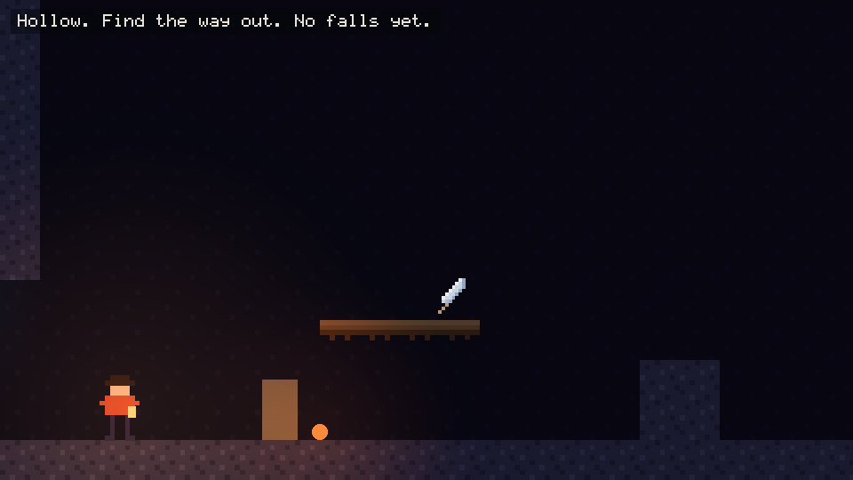
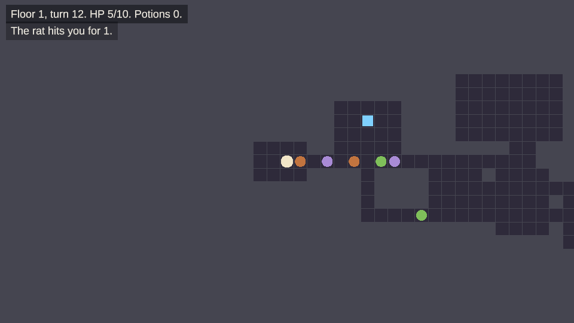
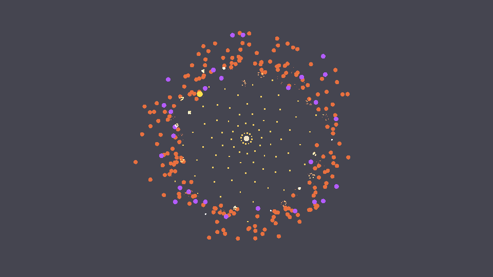
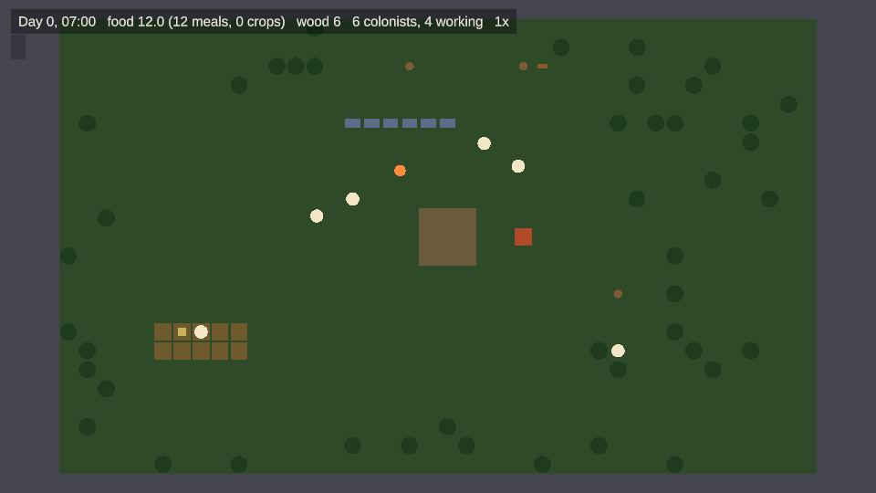

# Argus

**A 2D game engine you build games in together with an AI.**

| | |
|---|---|
|  |  |
| **Hollow**: a platformer with 2D lighting, dialogue, music, and rooms that stream in | **Delve**: a turn-based dungeon on a tilemap, with menus and potions |
|  |  |
| **Swarm**: an arena shooter with hundreds of enemies, the chase in a Rust plugin | **Outpost**: a colony where colonists find work, farm, cut wood, and eat |

Most game engines are made for one person sitting at an editor. Argus is made so an AI agent can work on a game as well as a person can, and alongside them. The game runs live in a background program that holds its whole world. You in the editor, an agent in Claude, Cursor, or Codex, the test runner, and the command line all work on that same live game through one protocol. So the agent is not guessing from source files: it can look at the game, play it, rewind it, test it, change it, and say what happened and why.

All four games above are examples in this repository, and each one also had a feature added by an AI agent that was given only the game and Argus's docs: a feather for a double jump in Hollow, healing potions in Delve, charging "dasher" enemies in Swarm, and woodcutting in Outpost.

## What it can do

**An agent that can see and play.** `observe` gives the agent the frame as data (what is on screen, where, and what it is, in about 3 KB) or as a picture. `run` and `seek` move time forward and back to any frame. `query` reads any entity, and `events` says what happened and what caused it.

**Every change is a step you can see and undo.** Edits go through the engine as transactions with a note and an author, human or agent, in one change feed. `propose` offers a change for you to try before it is kept.

**Same seed, same game.** A run is deterministic, bit for bit, on Windows, Linux, and in the browser. That is what makes the rest work: a failing test saves a replay that opens at the moment it failed, and when a player flags a moment while playing (a mark, with a note), the agent opens the game at exactly that frame.

**Tests that play the game.** A scenario drives the game with scripted input and checks what must stay true, over one seed or a hundred. A change is done when the scenarios pass.

**Tuning and speed as data.** Mark a field as tunable and sweep it across seeds to see which values hold up. `profile` reports each system's cost against the game's performance targets, and names the system to look at.

**A whole 2D engine.** Luau scripts that reload while the game runs; scenes as plain text files, one per entity; sprites, Aseprite, and Spine animation; 2D lighting with shadows and normal maps; particles and materials; UI with a screen-reader feed; sound and adaptive music; kinematic movement and rigid-body physics; navigation and jobs for crowds and colonies; tilemaps; dialogue and timelines; languages; saves; mods; and Rust plugins for the hot paths.

**Ships games.** `argus build` makes a release for Windows, Linux, or the web, checks that it plays and looks exactly as the project does, and needs no compiler. Steam support is built in.

**Made for people too.** An editor window with the live game, a hierarchy, an inspector, a timeline, tilemap painting, and a replay scrubber; and a review page that works on a phone.

## Fast, by design

Argus is built on its own entity-component system rather than a general-purpose one, because the protocol, the replays, and the speed all depend on how the world is stored.

- **Data laid out for the machine.** Components are stored column by column per archetype (structure of arrays), so a system that touches positions reads only positions, packed together. Tags cost nothing. A snapshot of the whole world is a copy of its columns: about a millisecond at 100,000 entities, which is why the engine can keep a keyframe every second and let you scrub back through a run.
- **Systems say what they touch.** Every system declares the components it reads and writes. The engine enforces it (touching an undeclared component is an error, not a race), the protocol can answer "what writes this?", and the scheduler uses it to run systems at the same time.
- **Multithreaded, and still deterministic.** Systems that do not touch the same components run in parallel batches on as many cores as the machine has: four heavy systems took 6.7 ms a tick on one thread and 2.0 ms on four. The world, every event, and even the string table come out identical tick by tick on 1, 3, or 4 threads, so a replay, a mark, or a test gives the same answer however many cores ran it. Changes a batch makes land after it, in run order; new strings are sealed during a batch, so an id never depends on which thread asked first.
- **Scripts where it is easy, Rust where it is hot.** Game logic is Luau, reloaded while the game runs. A hot system can move into a Rust plugin with the same declaration: Swarm's chase did, and the game reaches the same world, to the bit, every tick.
- **Measured, not hoped for.** The design sets eighteen performance targets, from 100,000 live entities at a 60 Hz sim to 250,000 particles under a millisecond, and CI checks every one on every run, in a release build on a laptop. The profiler (`profile`, or the editor's Profile tab) puts each system's cost beside the targets and names the system to look at.

| Measured | Target | Result |
|---|---|---|
| Swarm with the swarm on the hero, sim tick | under 6 ms | 1.6 ms |
| Outpost at 10x speed, 200 colonists and 20,000 items, sim tick | under 1.6 ms | 0.82 ms |
| Outpost fast-forward, headless | over 2,000 ticks a second | about 5,000 (a month of colony life in about 20 s) |
| Collision pass with 100,000 entities moving | | 0.43 ms (incremental; a rebuild was 2.2 ms) |
| Save and load at eight hours of play | under 200 ms and 500 ms | 64 ms and 247 ms |
| A web build's first load on a 20 Mbit link | under 5 s | 2.6 s |

Numbers from the phase 5 gate and item 5 (2026-10-08 and 09), on Kevin's laptop; [how it was built](docs/history.md) has the history, and [tuning and performance](docs/manual/tuning-and-performance.md) how to measure a game.

## Install

Argus runs on Windows 10 or 11 and on Linux (x86-64, Ubuntu 24.04 or newer). Releases are on this repository; with the GitHub CLI signed in:

```powershell
# Windows (PowerShell)
gh release download --repo KSamsoe/argus --pattern install.ps1
powershell -ExecutionPolicy Bypass -File install.ps1
```

```sh
# Linux
gh release download --repo KSamsoe/argus --pattern install.sh
sh install.sh
```

Then, in a new terminal:

```sh
argus new my-game --template platformer    # or blank, roguelike, arena, colony
cd my-game
argus test                                  # the template's scenarios pass
argus editor                                # the game in the editor
```

## Connect your AI

```sh
argus mcp setup claude-code    # or claude-desktop, cursor, vscode, codex, gemini
```

That adds Argus to the tool's own settings. Set up once with `--scope user`, and the agent can list your games, open one, or make a new one, from any folder. Claude Desktop can also install the `argus-<version>.mcpb` bundle from a release (Settings, Extensions, Advanced settings, Install Extension), which carries Argus inside it.

## Learn more

- **[The manual](docs/manual/README.md)**: how Argus works and how to do everything in it, from a first game to a release.
- **[Installing](docs/install.md)**: what a machine needs, every AI tool's setup, updating, and uninstalling.
- **`argus docs`**: the full reference, generated from the engine itself: every tool, protocol method, script function, test function, project file, and engine component. Every project's `ARGUS.md` carries the parts for that game.
- **[The design](docs/argus-engine-design-v0.3.html)**, **[how it was built](docs/history.md)**, and **[working on the engine](docs/developing.md)**, for changing Argus itself.

Argus is early: version 0.0.1, in a private repository, on Windows and Linux (no macOS yet).
