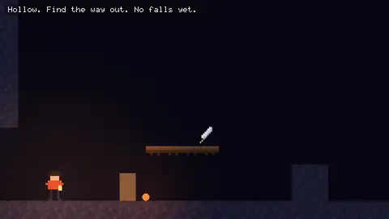
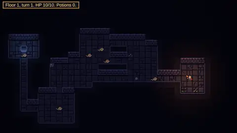
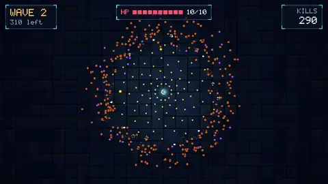
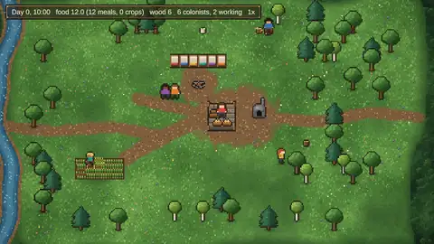
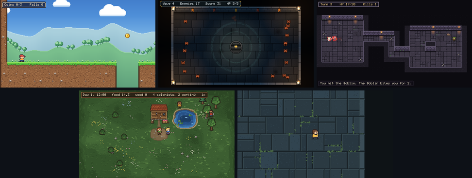

# Argus

**A 2D game engine you build games in together with an AI.**

| | |
|---|---|
|  |  |
| **Hollow**: a platformer with 2D lighting, dialogue, music, and rooms that stream in | **Delve**: a turn-based dungeon on a tilemap, with menus and potions |
|  |  |
| **Swarm**: an arena shooter with hundreds of enemies, the chase in a Rust plugin | **Outpost**: a colony where colonists find work, farm, cut wood, and eat |

Most game engines are made for one person sitting at an editor. Argus is made so an AI agent can work on a game as well as a person can, and alongside them. The game runs live in a background program that holds its whole world. You in the editor, an agent in Claude, Cursor, or Codex, the test runner, and the command line all work on that same live game through one protocol. So the agent is not guessing from source files: it can look at the game, play it, rewind it, test it, change it, and say what happened and why.

All four games above are examples in this repository, and each one also had a feature added by an AI agent that was given only the game and Argus's docs: a feather for a double jump in Hollow, healing potions in Delve, charging "dasher" enemies in Swarm, and woodcutting in Outpost.

## What it can do

**An agent that can see and play.** `observe` gives the agent the frame as data (what is on screen, where, and what it is, in about 3 KB) or as a picture. `run` and `seek` move time forward and back to any frame. `query` reads any entity, and `events` says what happened and what caused it.

**Every change is a step you can see and undo.** Edits go through the engine as transactions with a note and an author, human or agent, in one change feed. `propose` offers a change for you to try before it is kept.

**Same seed, same game.** A run is deterministic, bit for bit, on Windows, Linux, the Mac, and in the browser. That is what makes the rest work: a failing test saves a replay that opens at the moment it failed, and when a player flags a moment while playing (a mark, with a note), the agent opens the game at exactly that frame.

**Tests that play the game.** A scenario drives the game with scripted input and checks what must stay true, over one seed or a hundred. A change is done when the scenarios pass.

**Tuning and speed as data.** Mark a field as tunable and sweep it across seeds to see which values hold up. `profile` reports each system's cost against the game's performance targets, and names the system to look at.

**A whole 2D engine.** Luau scripts that reload while the game runs; scenes as plain text files, one per entity; sprites, Aseprite, and Spine animation; 2D lighting with shadows and normal maps; particles and materials; parallax; UI with rich text, text boxes, scrolling logs, and a screen-reader feed; touch controls; sound and adaptive music; kinematic movement and rigid-body physics, with box, circle, capsule, and polygon colliders; raycasts and shape queries; navigation and jobs for crowds and colonies; tilemaps; dialogue and timelines; languages; saves and save slots; mods; debug drawing; turn-based games that keep animating between turns; and Rust plugins for the hot paths.

**Ships games.** `argus build` makes a release for Windows, Linux, macOS (an app a player double-clicks), or the web (which plays on a phone, by touch), with the game's own name and icon, checks that it plays and looks exactly as the project does, and needs no compiler. Steam support is built in.

**Made for people too.** An editor window with the live game, a hierarchy, an inspector, a timeline, tilemap painting, and a replay scrubber; and a review page that works on a phone.

## Fast, by design

Argus is built on its own entity-component system rather than a general-purpose one, because the protocol, the replays, and the speed all depend on how the world is stored.

- **Data laid out for the machine.** Components are stored column by column per archetype (structure of arrays), so a system that touches positions reads only positions, packed together. Tags cost nothing. A snapshot of the whole world is a copy of its columns: about a millisecond at 100,000 entities, which is why the engine can keep a keyframe every second and let you scrub back through a run.
- **Systems say what they touch.** Every system declares the components it reads and writes. The engine enforces it (touching an undeclared component is an error, not a race), the protocol can answer "what writes this?", and the scheduler uses it to run systems at the same time.
- **Multithreaded, and still deterministic.** Systems that do not touch the same components run in parallel batches on as many cores as the machine has: four heavy systems took 6.7 ms a tick on one thread and 2.0 ms on four. The world, every event, and even the string table come out identical tick by tick on 1, 3, or 4 threads, so a replay, a mark, or a test gives the same answer however many cores ran it. Changes a batch makes land after it, in run order; new strings are sealed during a batch, so an id never depends on which thread asked first.
- **Scripts where it is easy, Rust where it is hot.** Game logic is Luau, reloaded while the game runs. A hot system can move into a Rust plugin with the same declaration: Swarm's chase did, and the game reaches the same world, to the bit, every tick.
- **Measured, not hoped for.** The design sets eighteen performance targets, from 100,000 live entities at a 60 Hz sim to 250,000 particles under a millisecond, and CI checks every one on every run, in a release build on a laptop. The profiler (`profile`, or the editor's Profile tab) puts each system's cost beside the targets and names the system to look at.

| Measured | Target | Result |
|---|---|---|
| Swarm with the swarm on the hero, sim tick | under 6 ms | 1.7 ms |
| Outpost at 10x speed, 200 colonists and 20,000 items, sim tick | under 1.6 ms | 1.2 ms |
| Outpost fast-forward, headless | over 2,000 ticks a second | about 3,500 (a month of colony life in about 30 s) |
| Collision pass with 100,000 entities moving | | 0.43 ms (incremental; a rebuild was 2.2 ms) |
| Save and load at eight hours of play | under 200 ms and 500 ms | 66 ms and 280 ms |
| A web build's first load on a 20 Mbit link | under 5 s | 2.6 s |

Numbers from the phase 5 gate and item 5 (2026-10-08 and 09), the games' rows measured again with their new art (2026-10-10), on Kevin's laptop; [how it was built](docs/history.md) has the history, and [tuning and performance](docs/manual/tuning-and-performance.md) how to measure a game.

## Why not an engine with an AI plugin?

The usual way to make games with an agent today is an existing engine with an assistant added to its editor: Unity with Coplay's MCP for Unity or Unity's own Unity AI, or Godot with an MCP server. Those plugins let an agent work the editor through its API: read the scene and its objects, read the console, run tests, and press the editor's buttons. That works, and it puts a large, proven engine behind the agent. Argus starts from the other end: the engine itself is built for an agent, so what an agent most needs is part of every game rather than something the plugin has to reach through the editor for.

| | An editor with an AI plugin | Argus |
|---|---|---|
| What the agent talks to | The editor, which has to be open, through the calls its plugin offers | The running game: a background program holds the live world, and the agent, the editor, the tests, and the command line all use the same protocol to reach it, with or without an editor open |
| What it sees | The scene's objects and their components, console logs, and screenshots | The frame as data, about 3 KB: what is on screen, where, and what it is; and an event log in which each event says what caused it |
| Time | Play mode runs forward, and a moment that went wrong is gone unless someone kept it | Run, step, and seek back to any earlier frame. Every run is the same, bit for bit, on Windows, Linux, and the Mac, and in the browser, so a moment a player flags opens at that exact frame, and a failing test hands over a replay |
| Knowing a change works | The engine's test framework, with the tests a team writes and wires up | Scenarios that play the game headless, over one seed or a hundred, in seconds; every template comes with them, and a change is done when they pass |
| Changes | Edits in the editor, with the editor's undo | Transactions with an author and a note, in one change feed; any one can be undone, and `propose` lets a person try a change before it is kept |
| The project | Scenes and prefabs saved in the engine's own formats, best changed through the editor | Plain text: one TOML file per entity, and Luau scripts that reload while the game runs; an agent can read, change, and diff all of it |
| What the agent reads to learn the engine | The engine's docs online, and what the model already knows | The manual and the reference compiled into the engine, matched to the installed version and readable over MCP, and an `ARGUS.md` in every project describing that game |
| Releasing | A build, checked by playing it | `argus build` checks that the release plays and looks as the project does, with no compiler needed |

Where the big engines are ahead, and will stay ahead for a while: 3D, which Argus does not do at all; decades of tools, an asset store, and a very large community; consoles, and phones and tablets as installed apps (an Argus game plays on them in the browser, by touch); and generated assets (Coplay and Unity AI make models, sound, and voices; Argus's examples draw their art with scripts). Argus is young, at version 0.2.1, and 2D only.

## Play the games

**[Play Hollow, Delve, and Outpost in your browser](https://argusengine.org/games/)**: the same games, tick for tick, drawn with WebGPU (or WebGL2). Click a game, then play with the keys its page lists. (Swarm runs its chase in a Rust plugin, which a page cannot load, so it plays on the desktop.) The site's front page, [argusengine.org](https://argusengine.org/), runs Hollow live with what an agent sees of it drawn over the game.

Each release also has the four games built and ready to run, nothing to install: `example-games-<version>` for Windows, Linux, or macOS (the Mac's without Swarm, whose Rust plugin is built on a Mac), on the [releases page](https://github.com/KSamsoe/argus/releases). Unpack it and run a game's program; its `README.txt` has the controls.

## Install

Argus runs on Windows 10 or 11, on Linux (x86-64, Ubuntu 24.04 or newer), and on macOS 11 or newer, Apple Silicon or Intel ([what each needs](docs/install.md#what-you-need)). Install it with one command:

```powershell
# Windows (PowerShell)
irm https://argusengine.org/install.ps1 | iex
```

```sh
# Linux and macOS
curl -fsSL https://argusengine.org/install.sh | sh
```

The installer takes the latest release from this repository and checks it against the release's checksums.

Then, in a new terminal:

```sh
argus new my-game --template platformer    # or blank, roguelike, arena, colony
cd my-game
argus test                                  # the template's scenarios pass
argus editor                                # the game in the editor
```

Each template is a small game that already plays, with its art drawn by a script in it that you or an agent can change, and scenarios that pin how it plays:



## Connect your AI

```sh
argus mcp setup claude-code    # or claude-desktop, cursor, vscode, codex, gemini
```

That adds Argus to the tool's own settings. Set up once with `--scope user`, and the agent can list your games, open one, or make a new one, from any folder. Claude Desktop can also install the `argus-<version>.mcpb` bundle from a release (Settings, Extensions, Advanced settings, Install Extension), which carries Argus inside it.

## Learn more

- **[The manual](docs/manual/README.md)**: how Argus works and how to do everything in it, from a first game to a release.
- **[Installing](docs/install.md)**: what a machine needs, every AI tool's setup, updating, and uninstalling.
- **`argus docs`**: the full reference, generated from the engine itself: every tool, protocol method, script function, test function, project file, and engine component. Every project's `ARGUS.md` carries the parts for that game.
- **Problems and ideas**: open an [issue](https://github.com/KSamsoe/argus/issues/new/choose) on this repository. Its templates ask for what helps: `argus version`, how to make it happen again, and a player's report if there is one. An agent that runs into something can write one too.
- **[The design](docs/argus-engine-design-v0.3.html)**, **[how it was built](docs/history.md)**, and **[working on the engine](docs/developing.md)**, for changing Argus itself.

Argus is young: version 0.2.1 is its first public release (0.1.0 was the first with a whole game made on it), on Windows, Linux, and macOS (cross-built on Linux, and tested on a Mac).

## License

Argus is open source under the [Apache License 2.0](LICENSE): use it for anything, free or paid, change it, and share your own version, keeping the copyright notice and the [NOTICE](NOTICE) file. A game you make with Argus is yours, under whatever terms you choose. The [templates](templates/LICENSE) and [example games](examples/LICENSE) are under MIT No Attribution, so a game started from one owes nothing for it.

The names "Argus" and "Argus Engine" are not part of the license: [TRADEMARKS.md](TRADEMARKS.md) says how to use them. Bug reports and ideas are welcome as issues; code from outside is not taken for now, as [CONTRIBUTING.md](CONTRIBUTING.md) explains.
