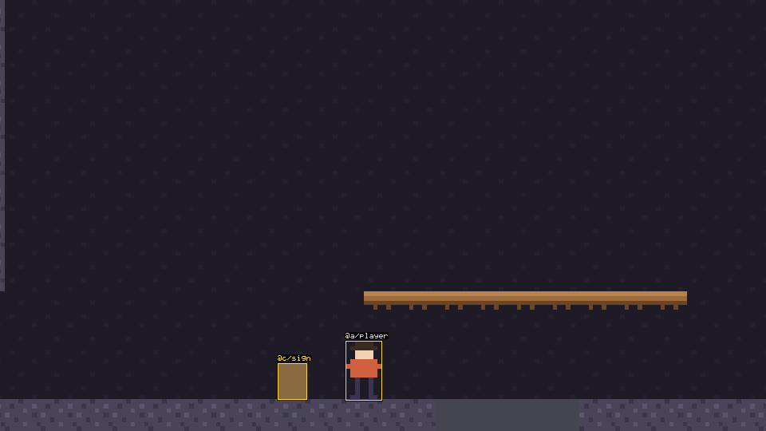
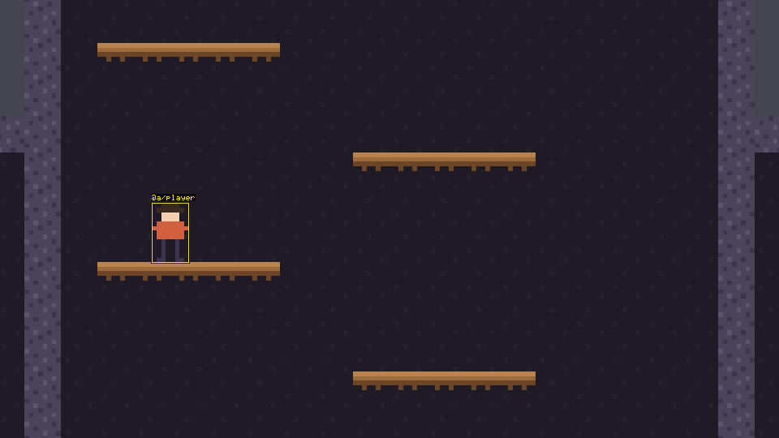
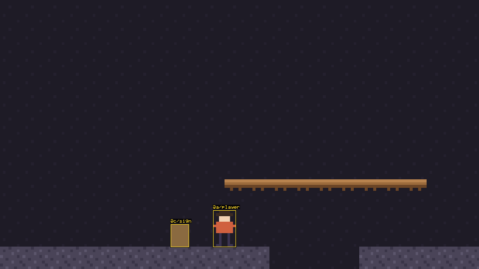
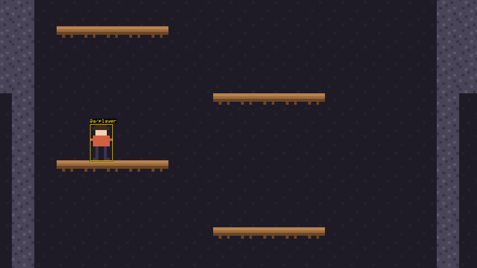

# Phase 1 gate

The plan (design §18) ends phase 1 with a gate:

> Swarm and Delve are playable by a human in a window. The agent builds a three-room slice of Hollow with tiles, a kinematic player, one-way platforms, and a following camera, screenshots it, describes what's on screen from the semantic frame, and fixes a visual bug it found that way. The player has a run, jump, and land animation with a footstep event that fires a sound.

This file records that run, done on 2026-09-22 with the phase-1 engine at commit `a9170c7` plus the fixes this commit adds. The gate has two halves, and both are done: the gate is passed. For the second half, Kevin played Swarm and Delve on 2026-09-23 and found two faults, both fixed. Both halves are below, with what was checked without a person.

## The brief

**Hollow.** A side-view platformer, three rooms long. The hero starts in a low cave, walks right through a doorway into a tall shaft, and can climb the shaft on wooden planks that can be jumped up through and stood on. A doorway at the foot of the shaft leads into a hall with a pit in its floor and a plank bridge over it. Falling into the pit puts the hero back at the cave mouth. The camera follows the hero and keeps to the room the hero is in. The hero idles, runs, jumps, falls, and lands, and each footstep makes a sound.

## What was built

The project is [examples/hollow](../examples/hollow). The agent wrote TOML, Luau, a level script, and an art script, and drove the engine only through `argus`.

| Piece | Where | What it is |
|---|---|---|
| Rooms | `scenes/hollow/scene.toml`, `rooms/a`, `rooms/b`, `rooms/c` | cave (x 0 to 24), shaft (x 24 to 44, twice as tall), hall (x 44 to 72); a graph a to b to c |
| Level | `scenes/hollow/level.tilemap.toml` and `level.chunks/` | 72 by 24 tiles in 32-tile chunks; layers back (decor), ground (rock, solid), planks (one-way) |
| Level script | `tools/level.sh` | the CLI calls that built the level: one `scene tiles create` and two transactions of `edit tiles` |
| Art | `tools/art.py` | writes the three 8 by 8 tiles and an 8-frame hero sheet (idle, four run frames, jump, fall, land) |
| Player | `rooms/a/player.toml` | Sprite, Collider, KinematicBody, CharacterController (run 7, jump height 3.2 over 0.36 s), PlayerSlot, Animator, Describe |
| Animation | `assets/anim/hero.toml` | idle, run, jump, fall, land; footsteps on run frames 0 and 2 play `sfx/step`; landing plays `sfx/land` |
| Camera | `rooms/a/camera.toml` | follows `@player` through a dead zone, height 12 tiles, zones from the room bounds, shake |
| Sound | `audio.toml` | described tones: `sfx/step` (noise), `sfx/land`, `sfx/fell` |
| Pit | `systems/pit.luau` | below y -3, the hero goes back to the cave mouth, `player.fell` is emitted, `sfx/fell` plays |
| Screen text | `rooms/a/hud.toml`, two signs | "Hollow. The hero is {state}.", "Mind the pit.", and one at the top of the shaft |
| Tests | `tests/run.luau`, `tests/planks.luau`, `tests/pit.luau` | below |

```
$ argus --project examples/hollow test
PASS  the pit puts the hero back at the cave mouth  (hollow, seed 1, 33 ms)
PASS  a plank is jumped through, stood on, and dropped through  (hollow, seed 1, 59 ms)
PASS  the hero runs from the cave through the shaft into the hall  (hollow, seed 1, 177 ms)
3 scenarios, 3 runs, 0 failed, 269 ms
```

The run scenario holds right, jumps the step in the cave, and checks the hero ends up in the hall. It also checks three camera zone changes, 20 or more footstep sounds, a jump and a landing in the animator, a landing sound, and a tick under 4 ms at p95. The planks scenario jumps up through a plank, stands on it, and drops through it with down and jump.

## Screenshots, the semantic frame, and the bug

The agent placed the hero at a few spots with `edit set`, let the world settle, and took two things at each: a PNG with every described entity boxed and labelled (`obs frame format=png annotate=true`), and the semantic frame (`obs frame format=semantic`). The semantic frame is text. It gives the camera's rect, the HUD, each entity with its screen box, and what the tiles in view collide with, one character a cell.

This is the hall, before the fix, with the empty rows in the middle cut:

```
$ argus obs frame format=semantic
Tick 895, 640x360 px. Camera @a/camera shows x 43.86 to 65.19, y 0.12 to 12.12.
HUD @a/hud: Hollow. The hero is idle.
@a/player hero: idle  at (289,285)-(320,335)  hero#0
@c/sign sign: Mind the pit.  at (232,303)-(257,334)  rect #8A6A40
Tiles of @a/level (scenes/hollow/level.tilemap.toml) from cell (43,11), one character a cell (# solid, - one-way, / and \ slopes, _ partial, . empty):
  #......................
  ...
  ...........---------...
  .......................
  .......................
  #############....######
(1019 bytes)
```

Read on its own, that says: the camera is in the hall. The hero stands idle on the floor, a little left of centre, with the sign just behind them. A plank bridge runs overhead. The floor is solid except for four empty cells at x 56 to 60, and that gap is the pit.

The picture did not say that. Under those four cells it showed a flat grey band, level with the rock on each side, which reads as more floor.



The two disagreed, and the semantic frame was right. Nothing was painted behind the pit, so the renderer's clear colour showed through, and the clear colour is close to the rock's grey. A player would walk into what looks like floor and fall.

The same comparison in the shaft found a second one. The shaft is 20 tiles wide and the camera's view is about 21.3, so the camera centres on the shaft and shows a strip of each neighbouring room. Above the cave's and the hall's ceilings nothing was painted either, and the view of the shaft had grey slivers at both top corners.



The fix is one more transaction in `tools/level.sh`, with a note saying why:

```
$ argus edit begin agent:claude note="The pit read as floor: paint the back wall into it, and fill the empty rock above the rooms"
$ argus edit tiles tx=4 file=scenes/hollow/level.tilemap.toml layer=back rect="{x: 56, y: 23, w: 4, h: 1}" tile=1
$ argus edit tiles tx=4 file=scenes/hollow/level.tilemap.toml layer=ground rect="{x: 0, y: 0, w: 24, h: 10}" tile=1
$ argus edit tiles tx=4 file=scenes/hollow/level.tilemap.toml layer=ground rect="{x: 44, y: 0, w: 28, h: 10}" tile=1
$ argus edit commit tx=4
```

Taken again, the pit is a dark gap with the back wall in it, and the shaft's corners are rock. The pit's tile rows did not change, because the back layer has no collision. The shaft's top rows changed from `.#` to `##`.





## Swarm and Delve in a window

On 2026-09-23 Kevin played Swarm and Delve from his own PowerShell. Both ran well. Two faults: the window's close button froze the game, which had to be killed from Task Manager (finding 9), and Delve opened on an empty screen with only the hero until the first move (finding 12). Both are fixed.

Checked before that, without a person:

- Swarm opened in a real window on the development machine: 1280 by 720, NVIDIA RTX 3070 Ti through Vulkan, 297 sprites in 3 draw calls at 0.99 ms a frame. The swarm was on screen around the player. Delve was not opened in a window this time. A daemon test covers a key press taking a turn in a playing Delve-style scene.
- The step from a key press to the game is tested without a window. The window sends a key under winit's name for it (`KeyW`, `ArrowLeft`). A new test sends every key the three games bind that way, through each game's own `input.toml`, and checks the action it drives. It also checks that a released key lets go and that losing focus lets go of everything. The step before that, a physical key reaching the window, is winit's job, and is what a person playing checks.
- Opening the game from outside the agent's shell found a real fault, finding 5 below. It is fixed.

To play, build once with `cargo build -p argus-cli`. `argus` is not installed on PATH: it is the built binary in `target\debug`. From the repository folder, in PowerShell:

```powershell
.\target\debug\argus.exe --project examples\swarm daemon start --window 1280x720 --play
```

```powershell
.\target\debug\argus.exe --project examples\delve daemon start --window 1280x720 --play
```

Swarm moves with WASD or a gamepad's left stick. Delve moves one cell per turn with the arrow keys or the d-pad; period waits a turn and Enter takes the stairs. To finish, stop the game's daemon:

```powershell
.\target\debug\argus.exe --project examples\swarm daemon stop
```

## Did it fight the protocol

Hollow needed nothing the protocol lacked, but building it found five faults, all fixed, and three limits worth recording.

**1. A room-scoped id was unreachable by its short name.** In a room scene an entity's id is `room/id`, so the hero is `a/player`. The HUD text said `{@player:Animator.state}` and printed `{?...}`. The pit script's `@player` faulted with "no entity with string id player". Now `@player` finds the one `*/player` when there is exactly one, and names the candidates when there are several.

**2. A script that faulted on its first tick was invisible.** The fault turned the system off, and `script.errors` said 0. Now a system a fault turned off is a row with `phase: "run"`, its file, line, and message, for as long as it stays off. `session.status` and the summary a scene load returns count the same list, which also brings in the material rows they were missing.

**3. Two overlapping holds cut each other short.** The hero stopped halfway across the shaft. The agent had injected "hold right" twice, and the first inject's automatic release fired in the middle of the second. Now a later inject of an action drops the earlier one's pending release.

**4. The test harness's `release` pressed instead.** `t.input:release` sent an inject with no value, which means the action's active value. It now sends the rest value for the action's type. Field paths in expectations also reach one axis of a vec2, as in `Transform.pos.x`.

**5. The binary only started from the agent's shell.** Luau is C++, so `argus.exe` loaded `libstdc++-6.dll` and `libwinpthread-1.dll` from PATH. On this machine a normal shell finds PostgreSQL's older `libwinpthread-1.dll` first, and the game stopped at an "entry point not found" dialog. The agent's shell had WinLibs first, so every test had passed. `.cargo/config.toml` now links both runtimes into the binary. Hollow's tests pass run from the plain system PATH.

And the limits:

**6. Art leaves the protocol.** A described-shape placeholder is one rect or circle, which is enough for Swarm and Delve. A tileset and an eight-frame hero sheet are not shapes. The agent wrote `tools/art.py`, a small script that writes the PNGs, and the importer took them from there. A placeholder that describes a sheet of frames would keep this inside the protocol. It is not built.

**7. Rooms stream on `scene.transition`, not on walking.** The camera's zone follows the hero from room to room, but the scene's current room only changes on `scene.transition`. Hollow sets the streaming radius to 2, so all three rooms stay loaded. A full-size Hollow needs streaming that follows the player.

**8. A room narrower than the view shows its neighbours.** The camera keeps to the room's bounds where it can. When the room is narrower than the view, it centres, and the view includes a strip of the next rooms. That is what exposed the shaft's slivers. The level fix was right for Hollow, and the behaviour is stated in the camera trace.

One process note, from the part the agent tried by hand. Driving the real desktop to press keys on the window took the keyboard and screen from the person using the machine at the same time. The desktop tool's "open application" also started fresh copies of `argus.exe` instead of focusing the running one, and those copies raised the dialog in finding 5. Checks that need a person's screen are now scheduled with that person.

A small one: the hero sheet is 64 by 13 pixels, and the importer pads it to 64 by 16 with an `asset.warning` on every load. It draws correctly.

### After the gate

Kevin's play sessions found two more faults, and fixing them and re-timing the tests found two more.

**9. The close button froze the game.** Closing the window dropped its event loop first and the window after. winit destroys a window by posting it a message, which the loop has to run to handle, so the window stayed on screen with nothing answering it, Windows marked it not responding, and the process lived on. And winit allows one event loop a process, so no window could have opened after the first closed. Now closing drops the renderer, then the window, pumps the loop until the window is gone, and keeps the loop for the next window. A window opened with `--window` at start is the person's, and closing it also stops the daemon; one an agent opens with `render.window` only closes. Tests press the close button on hidden windows by sending the message it sends, so they run while someone uses the machine.

**10. Delve's tests had become five times slower.** They took 5.2 s, where the phase-0 build takes 1.5 s on the same machine. Building each phase-1 commit and timing the tests put most of it at item 3, the mixer. With no device open, the daemon mixes as far as the sim clock, and a discrete game's turn is one second, so every turn mixed a second of zeros through every bus. Silence now takes a short path that leaves the same state. Timing each step of a scene load found the rest: every reload rewrote the index's schemas, systems, prefabs, and defs, a third of the reload once phase 1 had added its components. Those are now written only when they change. Delve's tests take 2.4 s.

**11. A command right after `daemon stop` failed.** `stop` returned when the daemon agreed to go, not when it had gone, and the next command reached the daemon on its way out and reported "connection lost". It dates from phase 0. `stop` now waits until the daemon's record is removed and its socket is silent.

**12. Delve opened on an empty screen.** Its floor is generated by `sim.floor`, a system in the `sim` stage. Stages run on ticks, and a discrete clock ticks on the first command, so until the first key the window showed the hero alone. Every test advanced a turn before looking, so none saw it. The design's stages have no place for a game to build its world before play starts. Now a system can be declared `on_load = true`: it also runs once when the scene loads, before the first tick, from the same seed, so the floor is the same one. `sim.floor` is declared that way. What such a system emits belongs to the run, so a scene load reports where the run's events begin, and the test harness starts there. The stairs scenario now checks the floor exists at turn 0.

## Numbers

| Measure | Value |
|---|---|
| Level | 72 by 24 tiles, 3 layers, 32-tile chunks |
| CLI calls to build the level | 32, in 2 transactions |
| Hollow's tests | 3 scenarios in 269 ms |
| Hollow tick, 600 ticks of running, debug build | 0.18 ms at p95 |
| Semantic frames at the cave, shaft, and hall | 904, 933, and 1,019 bytes |
| 600 ticks of holding right | 48 footsteps, each an `sfx/step` the mixer answered; 3 landings; 1 fall into the pit at frame 502 |
| Camera zone changes on that run | frame 201 into the shaft, 373 into the hall, 502 back to the cave after the fall |
| Swarm in a window, debug build | 1280 by 720, 297 sprites, 3 draw calls, 0.99 ms a frame |
| Delve's tests, debug build | 5.2 s before finding 10, 2.4 s after; the phase-0 build takes 1.5 s |
| A Delve scene reload, debug build | 18.5 ms before finding 10, 12.4 ms after; the index sync went from 6.6 ms to under 1 ms |
